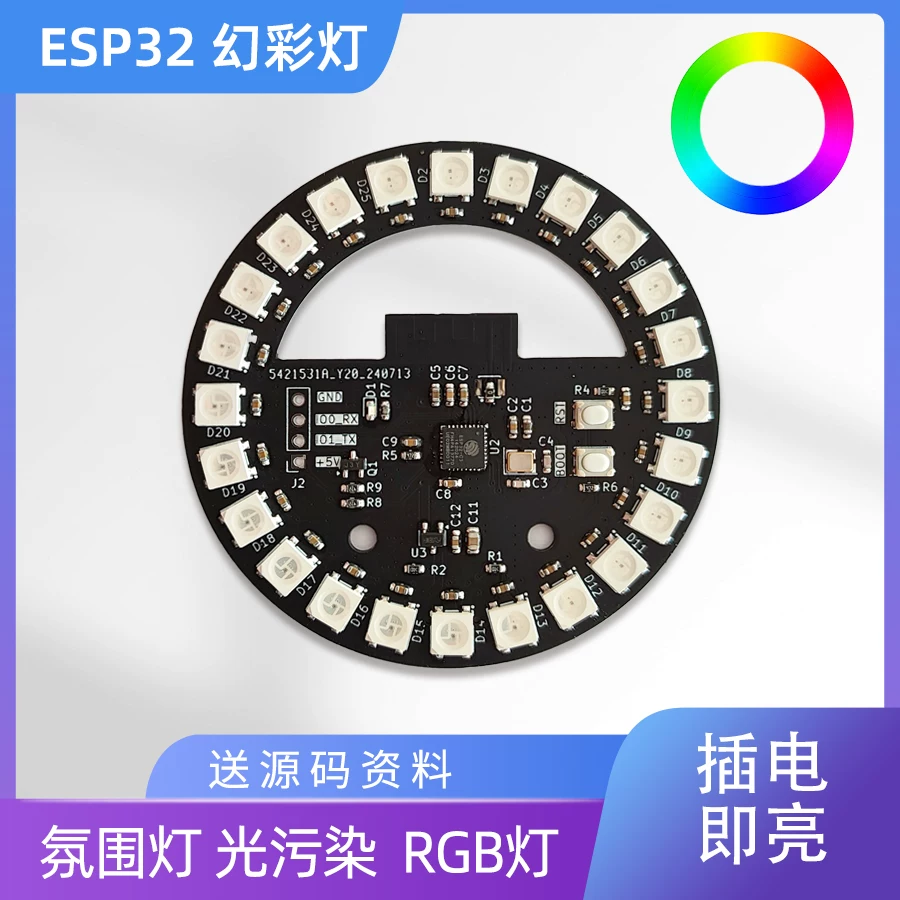

# AgentAura Plugin

将 QwenPaw 智能体（AI Agent）的生命周期事件实时同步到 PetDesktop 桌宠或 ESP32 硬件。
当 QwenPaw 启动、收到消息、思考、调用工具、等待审批、出错、关闭时，
环形灯会切换到对应的灯效，让智能体的运行状态一目了然。

支持 **HTTP / UDP / USB 串口** 三种连接方式，通过前端配置页面可视化选择。

## 当前已支持的设备

本插件当前支持以下 ESP32 RGB 灯板：

- ESP32 开发板圆形幻彩灯 WS2812B 圆环灯板



## 工作原理

```
QwenPaw 查询流 ─────┐
                    ├─> runner.py / approval.py ─> mapper.py
ApprovalService ────┘                                        │
                                                              ▼
                                                   client.py (transport)
                                                      │ ┌─────┴─────┐
                                                      │ │  http     │ ─> POST /api/cmd
                                                      │ │  udp      │ ─> UDP port 8888
                                                      │ │  serial   │ ─> USB CDC 115200
                                                      │ └───────────┘
                                                      ▼
                                            ESP32 Ring Light
```

1. **事件捕获**：`runner.py` 包装 `Workspace.stream_query`（QwenPaw 2.3.0
   的官方查询入口），`approval.py` 包装 `ApprovalService` 的审批方法，复用
   `qwenpaw-pet` 的成熟捕获逻辑。
2. **事件映射**：`mapper.py` 把 QwenPaw 事件映射到固件的
   `agent <状态>` 指令（见下表），并通过去抖避免相同状态频繁重启灯效。
3. **设备控制**：`client.py` 通过策略模式支持三种传输方式（HTTP REST /
   UDP 数据报 / USB 串口）。HTTP 自动识别 PetDesktop v1 API 或 ESP32 固件；连接 PetDesktop 时注册独立 Agent、维持 10 秒心跳并发送状态与气泡。
4. **设备发现**：`discovery.py` 向每个 IPv4 网卡的广播地址及全局广播地址发送 UDP 探测，虚拟网卡或 VPN 不会遮蔽局域网设备。

## 事件 → 灯效映射

| QwenPaw 事件 | ESP32 状态 | 灯效 | 说明 |
|:---|:---|:---|:---|
| `qwenpaw.startup` | `init` | 🌈 彩虹 | QwenPaw 启动 |
| `qwenpaw.shutdown` | `offline` | 🌑 关灯 | QwenPaw 关闭 |
| `query.received` | `running` | 🟢 绿色呼吸 | 收到新消息 |
| `query.running` | `busy` | 🟡 黄色跑马 | 思考中 |
| `tool.detected` | `busy` | 🟡 黄色跑马 | 调用工具 |
| `query.first_token` | `busy` | 🟡 黄色跑马 | 开始回复 |
| `query.done` | `idle` | 🔵 蓝色呼吸 | 完成，回到空闲 |
| `query.cancelled` | `idle` | 🔵 蓝色呼吸 | 取消，回到空闲 |
| `query.error` | `error` | 🔴 红色闪烁 | 出错 |
| `approval.pending` | `waiting` | 🟡 黄色闪烁 | 等待审批 |
| `approval.approved` | `busy` | 🟡 黄色跑马 | 审批通过，继续执行 |
| `approval.denied` | `error` | 🔴 红色闪烁 | 审批拒绝 |
| `approval.timed_out` | `error` | 🔴 红色闪烁 | 审批超时 |
| `approval.bulk_cancel` | `idle` | 🔵 蓝色呼吸 | 审批批量取消 |

> 状态映射与固件 [`doc/API.md`](../../Arduino_ESP32_RingLight/ESP32_RingLight_Firmware/doc/API.md) §9 完全对应，无需扩展固件。

## 连接方式

| 传输方式 | 适用场景 | 需要的硬件 | 默认端口 |
|:---|:---|:---|:---|
| **HTTP** | WiFi 局域网（推荐） | 设备连接 WiFi | 80 |
| **UDP** | WiFi 局域网（低延迟） | 设备连接 WiFi | 8888 |
| **USB 串口** | 直连开发调试 | USB 数据线 | 115200 baud |

三种传输共用同一套文本指令格式（`agent <state>` / `rgb R,G,B` / `effect <name>` 等），
切换传输方式只需在前端页面选择即可，无需重启 QwenPaw。

> **版本要求：QwenPaw >= 2.3.0。** 本版起不再兼容 1.x / 2.0–2.2
> （这些版本的查询入口还是 `AgentRunner.query_handler`，且没有 2.3.0 的
> 依赖门禁与插件生命周期约束）。QwenPaw ≤ 2.1.0 请使用上一个发行包。

## 安装

### 方式一：从 QwenPaw 控制台

在插件管理页面安装 `agentaura`，可指向本地文件夹、上传 `.zip`
或粘贴插件 URL。

### 方式二：从命令行

```bash
# 先用打包脚本生成 zip（见下方"打包"小节）
qwenpaw plugin install ./agentaura-0.3.1.zip
```

> **注意**：本插件支持热加载——安装后无需手动重启 QwenPaw。路由挂载、
> 猴子补丁和前端 bundle 都在启动钩子中动态注册；前端 URL 带
> `?v=<版本号>-<bundle 指纹>`，**同一版本号下重新构建也会强制刷新缓存**
> （`src/frontend.py`）。如果页面未自动刷新，可手动刷新浏览器（`Ctrl+R`）。

### Python 依赖

插件**只声明一个硬依赖**，其余为可选项：

| 依赖 | 是否必需 | 用途 |
|:---|:---|:---|
| `httpx>=0.27` | ✅ 必需 | HTTP 传输（QwenPaw 自身已依赖） |
| `pyserial>=3.5` | ⬜ 可选 | USB 串口传输 + 串口枚举 |
| `psutil>=5.9` | ⬜ 可选 | 枚举所有网卡用于 UDP 设备发现（缺失时退回标准库方案） |

> **为什么可选依赖不写进 `plugin.json` / `requirements.txt`？**
> QwenPaw **2.3.0 起**在启动时先执行 `DependencyGate`（`allow_install=False`），
> 只要声明的依赖在插件运行环境里缺失一个，整个插件就会被标记为
> `failed`，后端根本不会被导入（插件管理页显示"插件异常"）。
> `pyserial` / `psutil` 因此改为懒加载 + 优雅降级。

**可选依赖由插件自己安装，不需要你手动 pip：**

- 插件安装/更新后首次启动，`src/deps.py` 会在后台把缺失的可选依赖装进
  QwenPaw 的插件依赖目录（`plugin_runtime/<py-tag>/site`，位于 `working`
  卷内，容器重建也不丢），本次启动即可生效；
- 前端串口页也有「安装串口依赖」按钮，对应接口 `POST /api/agentaura/deps/install`，
  可随时手动触发；
- 不想自动装（离线/受控环境）时：插件配置里关闭 `auto_install_deps`，或设置
  环境变量 `AGENTAURA_AUTO_INSTALL_DEPS=0`。归档环境请用插件运行的解释器手动安装：

```bash
# 在插件实际运行的解释器里执行（容器部署通常是 /app/venv/bin/python）
python -m pip install pyserial psutil
```

安装完成后 `GET /api/agentaura/status`、`/serial-ports` 会返回
`"pyserial_available": true`，前端串口下拉框才可用；`/deps` 可查看依赖状态与
最近一次安装日志。

补充说明：

- 安装/更新插件本身就会触发启动钩子，因此**装完插件后串口依赖会立刻就绪，
  无需重启 QwenPaw**；点击「安装串口依赖」按钮同理；
- 已装好的包放在 `working` 卷里，容器重建/升级镜像后不会丢；下次启动时插件会把
  该目录重新挂回 `sys.path`（`src/deps.py: expose_install_target`），不会重复下载；
- 桌面冻结版（frozen build）若自带解释器里没有 pip，自动安装会失败并给出明确提示，
  此时按上面的手动命令处理即可。

## QwenPaw 版本兼容性

| 插件版本 | 适配的 QwenPaw | 说明 |
|:---|:---|:---|
| **0.3.1**（当前） | **2.3.0 – 2.98.x** | 只保留 2.3.0 的接口实现，无低版本分支 |
| 早期 0.3.x | ≤ 2.1.0 | 包装已删除的 `AgentRunner`，在 2.3.0 上表现为"插件异常" |

本版针对 QwenPaw 2.3.0 的大量接口重构做了以下适配：

| QwenPaw 变更 | 影响 | 插件侧处理 |
|:---|:---|:---|
| 启动时强制校验 `dependencies`（不再自动安装） | 缺 `pyserial` → 插件 `failed`，页面请求全部 404 | 只保留 `httpx` 为硬依赖；可选依赖懒加载 + 由插件自己 `pip install` 到插件依赖目录 |
| `qwenpaw.app.runner.runner` 被删除 | 1.x 的 `AgentRunner.query_handler` 补丁全部失效，灯效不再联动 | 改为补 `Workspace.stream_query`（2.0–2.3 的官方查询入口） |
| 内容块改为 `TextContent` / `DataContent`（不再有 `tool_use` / `tool_result`） | 工具调用无法识别 | 从 `DataContent.data` 的 `FunctionCall` / `FunctionCallOutput` 识别工具调用与结果 |
| `ApprovalService.resolve_request` 新增 `scope` / 关键字参数 `actor` | 审批通过/拒绝时报 `TypeError`，审批流程被卡住 | 包装函数改为透明转发 `*args/**kwargs` |
| 启动钩子抛异常会直接判定插件失败 | 发现设备（UDP 1.5s）等副作用可能拖垮插件 | 每个副作用独立 try/except，设备发现移到后台线程 |
| `qwenpaw_version` 语义为 `>=min, <max` | 原先 `min: 1.1.5, max: 2.1.0` 完全排除了 2.3.0（上限校验此刻被暂时关闭，随时可能恢复） | 改为 `min: 2.3.0, max: 2.99.0`（即允许 2.3.0 ≤ 版本 < 2.99.0），`min_version` 同步为 `2.3.0` |

## 配置

### 1. 前端配置页面（推荐）

安装插件后，QwenPaw 控制台侧边栏出现 **💡 AgentAura** 页面：

1. **连接状态**：显示当前传输方式、设备在线状态、当前灯效
2. **连接配置**：
   - 选择连接方式（HTTP / UDP / USB 串口）
   - HTTP/UDP：填写设备 IP 和端口
   - 串口：从下拉列表选择串口（自动枚举），缺 pyserial 时可一键安装，设置波特率
   - 开关：启动时自动发现设备
   - 状态去抖毫秒数
3. **设备发现**：点击「扫描设备」UDP 广播查找局域网内设备，点击「填入配置」一键填入 IP
4. **灯效测试**：点击 `agent running` / `agent busy` 等按钮直接发送状态指令验证灯效

### 2. 环境变量（启动前设置）

```bash
AGENTAURA_TRANSPORT=http           # http / udp / serial
AGENTAURA_HOST=192.168.1.100       # http/udp 模式
AGENTAURA_PORT=80                  # http 默认 80，udp 默认 8888
AGENTAURA_SERIAL_PORT=COM3         # serial 模式
AGENTAURA_BAUD=115200              # serial 波特率
AGENTAURA_DEBOUNCE_MS=500
AGENTAURA_AUTH_TOKEN=my-secret     # HTTP Bearer Token（可选）
```

### 3. HTTP API

```bash
curl -X POST http://localhost:8000/api/agentaura/connection-config \
  -H 'Content-Type: application/json' \
  -d '{
    "transport": "http",
    "host": "192.168.1.100",
    "port": 80,
    "debounce_ms": 500,
    "auth_token": "my-secret",
    "auto_discover": true
  }'
```

## HTTP API

所有路由挂载在 `/api/agentaura` 下：

| 方法 | 路径 | 说明 |
|:---|:---|:---|
| `GET` | `/status` | 插件 + 设备状态（含插件/QwenPaw 版本、pyserial 是否可用、当前传输方式） |
| `GET` | `/devices` | UDP 扫描发现设备 |
| `GET` | `/serial-ports` | 枚举可用串口（需 pyserial，返回 `pyserial_available` 便于前端提示） |
| `POST` | `/connection-config` | 设置传输方式 + 连接参数 |
| `POST` | `/config` | 旧版配置接口（兼容别名） |
| `POST` | `/agent` | 手动切换 agent 状态（用于调试） |
| `POST` | `/test` | `/agent` 的别名 |
| `POST` | `/test-event` | 模拟发送一个 QwenPaw 事件，走完整映射流程 |
| `POST` | `/command` | 发送任意文本指令（如 `rgb 255,0,0`） |
| `GET` | `/state` | 代理访问设备的状态查询 |
| `GET` | `/deps` | 可选依赖状态（pyserial / psutil 是否可用、安装目录、上次安装结果） |
| `POST` | `/deps/install` | 立即安装缺失的可选依赖（白名单：`serial` / `psutil`） |

### 示例

```bash
# 扫描设备
curl http://localhost:8000/api/agentaura/devices

# 枚举串口
curl http://localhost:8000/api/agentaura/serial-ports

# 切换到串口模式
curl -X POST http://localhost:8000/api/agentaura/connection-config \
  -H 'Content-Type: application/json' \
  -d '{"transport": "serial", "serial_port": "COM3", "baud": 115200}'

# 手动测试灯效
curl -X POST http://localhost:8000/api/agentaura/agent \
  -H 'Content-Type: application/json' \
  -d '{"state": "busy"}'

# 模拟事件
curl -X POST http://localhost:8000/api/agentaura/test-event \
  -H 'Content-Type: application/json' \
  -d '{"event": "query.error"}'

# 发送原始指令
curl -X POST http://localhost:8000/api/agentaura/command \
  -H 'Content-Type: application/json' \
  -d '{"command": "rgb 255,0,0"}'
```

## 目录结构

```
qwenpaw-plugin/
├── plugin.json            # 清单：id/name/version/dependencies/entry/config
├── plugin.py              # 入口：注册 startup/shutdown hooks + HTTP router
├── requirements.txt       # httpx（可选依赖以注释形式给出）
├── src/                   # 后端源码（平铺模块）
│   ├── client.py          #   多传输客户端（http/udp/serial 策略模式）
│   ├── discovery.py       #   UDP 广播发现设备
│   ├── mapper.py          #   事件 → agent 状态映射 + 去抖
│   ├── runner.py          #   patch Workspace.stream_query（QwenPaw 2.3.0）
│   ├── approval.py        #   patch ApprovalService
│   ├── deps.py            #   可选依赖自动安装（pyserial / psutil）
│   └── router.py          #   FastAPI 路由（配置/发现/串口/测试）
├── tests/                 # unittest：客户端、事件分类、补丁/恢复
│   ├── test_client.py
│   ├── test_runner.py
│   └── test_deps.py
├── ui/                    # 前端 UI（Vite + React + Ant Design）
│   ├── src/
│   │   ├── index.tsx      #   配置页面（连接方式/IP/串口/发现/测试）
│   │   └── qwenpaw-host.d.ts  # QwenPaw 宿主 API 类型声明
│   ├── package.json
│   ├── vite.config.ts
│   ├── tsconfig.json
│   └── .npmrc
├── dist/
│   └── index.js           # 构建产物（打包时自动生成，前端 entry）
├── scripts/
│   ├── pack.ps1           # Windows 打包脚本（含前端构建）
│   └── pack.sh            # macOS/Linux 打包脚本（含前端构建）
└── README.md              # 本文件
```

## 前端开发

前端使用 Vite + React + Ant Design，共享 QwenPaw 宿主的 React/antd 运行时（不重复打包）。

```bash
cd ui
npm install
npm run build    # 输出到 ../dist/index.js
```

构建产物 `dist/index.js` 被 `plugin.json` 的 `entry.frontend` 引用，
QwenPaw 控制台启动时自动加载。

> 修改 `ui/src/` 后需重新 `npm run build` 并重装插件（或直接复制
> `dist/index.js` 到 `~/.qwenpaw/plugins/agentaura/dist/`）。

## 设计要点

- **多传输**：HTTP / UDP / USB 串口三种连接方式，策略模式实现，运行时切换无需重启。
- **零阻塞**：所有设备通信都是 fire-and-forget，350ms 超时 + 离线冷却，
  设备掉线时静默跳过，绝不影响 QwenPaw 主流程。
- **去抖**：相同 agent 状态在 `debounce_ms`（默认 500ms）内不重复发送，
  避免 `busy → busy` 重启灯效闪烁。
- **降级**：QwenPaw patch 失败（如上游入口再次改名）只记录日志，HTTP 路由
  仍可用于手动控制；串口/psutil 缺失时同样优雅降级。
- **单一目标**：只依赖 QwenPaw 2.3.0 的稳定入口（`Workspace.stream_query`、
  `ApprovalService`），按 2.3.0 的启动/依赖契约收敛副作用。不再保留
  1.x/2.0–2.2 的回退分支，代码里没有"版本探测"这种长期维护负担。

## 测试

```bash
cd Agent_Plugin/qwenpaw-plugin
python -m unittest discover -s tests -t . -v
```

无需安装 QwenPaw：测试只覆盖事件分类、流包装与补丁/恢复逻辑。
- **复用**：事件捕获逻辑直接基于 `qwenpaw-pet` 精简，保证与 QwenPaw
  内部 API 的兼容性。

## 打包

打包脚本会自动构建前端 bundle 再打 zip：

```bash
# Windows
powershell -ExecutionPolicy Bypass -File scripts/pack.ps1

# 跳过前端构建（dist/index.js 已是最新时）
powershell -ExecutionPolicy Bypass -File scripts/pack.ps1 -SkipFrontendBuild

# macOS / Linux
bash scripts/pack.sh

# 跳过前端构建
bash scripts/pack.sh --skip-frontend
```

生成的 `.zip` 位于 `dist/` 目录，可直接用 `qwenpaw plugin install` 安装。
